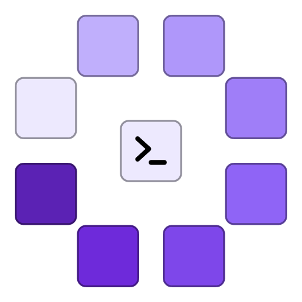

<p align="center">
  
</p>

<h1 align="center">Gespan</h1>

<p align="center">
  <strong>A GUI for your coding agents.</strong>
</p>

Works with your subscriptions on Claude Code, Codex, Cursor, Grok Build, OpenCode, Antigravity, Pi, omp, fx, Hermes Agent, Kiro CLI, and Devin. If they’re installed and logged in, Gespan can run them. Tabs are sessions. The composer is the input. Gespan does not sell tokens.

## About the name

**Gespan** (say it "guh-SPAHN") is a Dutch word for a *span*: a team of draught animals, horses or oxen, harnessed together to pull the plough and the wagon on the farm before the work was mechanised. One driver, several animals, all pulling in the same direction.

That is what this app does for coding agents. You hold the reins, and a team of agents does the pulling.

This is the reason we are changing the project's name, and Gespan is the name we will use moving forward.

## Install

Install and sign in to at least one supported agent first. See [provider setup](docs/providers.md) for instructions.

| Platform | Download |
| --- | --- |
| macOS, Apple Silicon | [Gespan.dmg](https://github.com/0xvasanth/gespan/releases/latest) |
| macOS, Intel | [Gespan_x64.dmg](https://github.com/0xvasanth/gespan/releases/latest) |
| Linux, x86_64 | [.deb, .rpm, or AppImage](https://github.com/0xvasanth/gespan/releases/latest) |
| Windows, x86_64 | [Installer](https://github.com/0xvasanth/gespan/releases/latest) |

On macOS, open the DMG and drag Gespan to Applications. On Windows, run the installer. See [Linux setup](docs/install.md) for dependencies and package instructions.

Installers appear on the [Releases page](https://github.com/0xvasanth/gespan/releases) once a release is published. Until then, [build from source](#build-from-source).

## Get started

Open a project folder, choose an agent, and send a message. Each tab is a session. Split panes to work with sessions side by side.

- Keep conversations organized by project.
- Use separate Git worktrees for parallel tasks.
- Edit files and review changes in the app.
- Start a message with `/operator` to let an agent open sessions and manage worktrees and notes.

Pilots are experimental agents that work across your projects. They keep a memory and can run scheduled tasks you set up with them.

Gespan is still early. If something breaks, [report a bug](https://github.com/0xvasanth/gespan/issues).

## Guides

- [Provider setup](docs/providers.md)
- [Linux installation](docs/install.md)
- [Agent access with /operator](docs/agent-access.md)
- [Remote sessions, experimental](docs/remote-access.md)

## Build from source

You’ll need Node.js 20+ and a stable Rust toolchain. See [build setup](docs/building.md) for platform dependencies and packaging.

The mobile app is a separate Expo project in [`mobile/`](mobile/README.md). Run it with `cd mobile && bun install && bun run start`.

```bash
bun install
bun run tauri dev
```

Small, focused contributions are welcome. Read [CONTRIBUTING.md](CONTRIBUTING.md) before opening a pull request.

## Gespan Native preview

The Rust + GPUI app is an experimental preview. React/Tauri remains the
production app.

To try GPUI from this checkout with Node.js 22+, Rust and Xcode on macOS:

```sh
bun run native:dev     # launch with a separate development database
bun run native:build   # create an optimized app using installed Gespan data
```

Type `r` then Enter in the development terminal to rebuild and restart; there is
no hot reload. The release app saves changes to your installed Gespan data.
See the [native guide](docs/native/README.md) for prerequisites, build output,
checks and preview limitations.

Gespan Native shares `~/Library/Application Support/dev.gespan.desktop/gespan.db`
with Gespan. Back up `gespan.db` with both apps closed before first using Gespan
Native, and do not open the same conversation in both apps at once: Gespan saves
whole conversations and can overwrite turns added in Gespan Native.

## Contributors

Thanks to everyone who contributes to Gespan!

[](https://github.com/0xvasanth/gespan/graphs/contributors)

Contributor image by [contrib.rocks](https://contrib.rocks).

## License

[MIT](LICENSE). Provider names and logos are trademarks of their owners. See [NOTICE](NOTICE).
