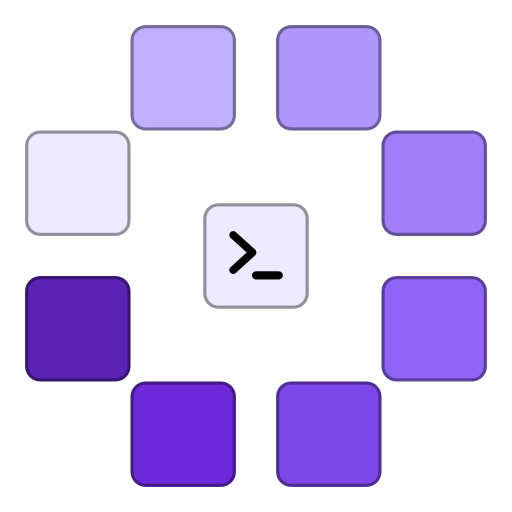
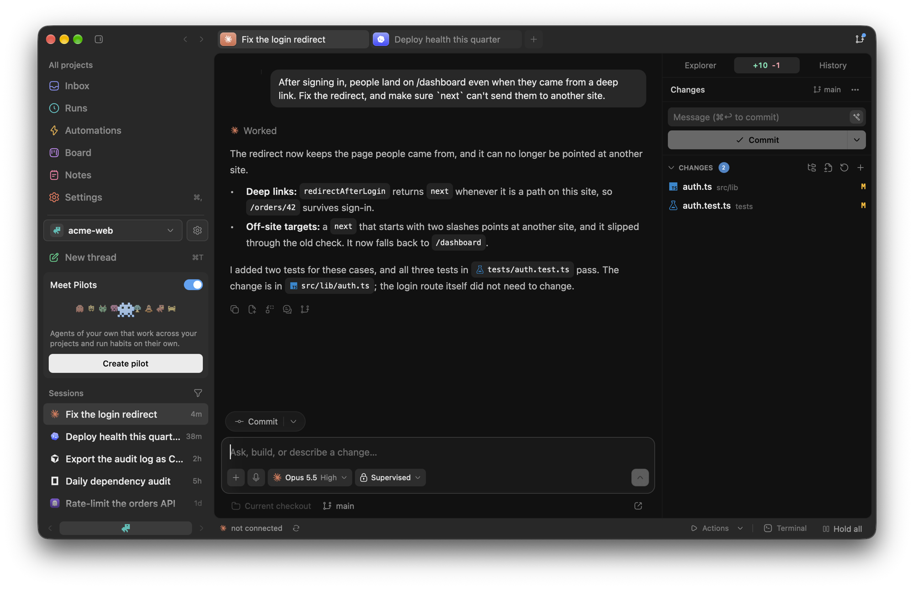
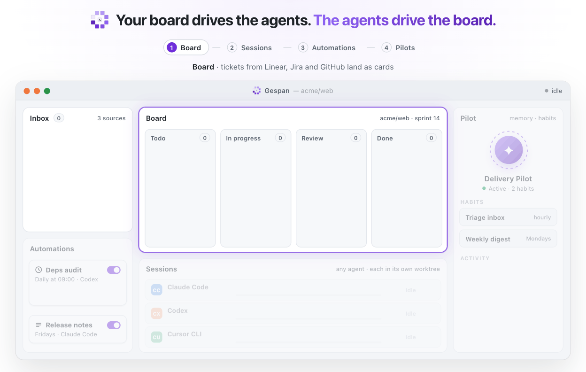

<a id="top"></a>

<p align="center">
  <a href="https://github.com/0xvasanth/gespan">
    
  </a>
</p>

<h1 align="center">Gespan</h1>

<p align="center">
  <strong>One desktop app to drive all of your coding agents.</strong>
</p>

<p align="center">
  Run Claude Code, Codex, Cursor, OpenCode and eight more coding agents side by side,<br/>
  plan their work on a board, and let a Pilot keep it moving.<br/>
  It uses the subscriptions you already pay for. No new accounts and no token resale.
</p>

<p align="center">
  <a href="#install"></a>
  <a href="#install"></a>
  <a href="#install"></a>
</p>

<p align="center">
  <a href="https://github.com/0xvasanth/gespan/actions/workflows/ci.yml"></a>
  <a href="https://github.com/0xvasanth/gespan/releases"></a>
  <a href="LICENSE"></a>
  <a href="https://github.com/zed-industries/zed/tree/main/crates/gpui"></a>
  <a href="https://github.com/0xvasanth/gespan/stargazers"></a>
</p>

<p align="center">
  <a href="#how-it-works">How it works</a> ·
  <a href="#supported-agents">Agents</a> ·
  <a href="#features">Features</a> ·
  <a href="#install">Install</a> ·
  <a href="#quick-start">Quick start</a> ·
  <a href="#documentation">Docs</a> ·
  <a href="#faq">FAQ</a> ·
  <a href="#contributing">Contribute</a>
</p>

<p align="center">
  
</p>

---

> **Gespan** (*guh-SPAHN*) is Dutch for a team of horses or oxen harnessed
> together to pull one wagon. You hold the reins, and a team of agents does the pulling.

## How it works

<picture>
  <source media="(prefers-color-scheme: dark)" srcset="docs/assets/how-it-works-dark.gif" />
  
</picture>

1. **Board.** Tickets from GitHub, GitLab, Linear, Jira and Azure DevOps land in
   the Inbox and become cards.
2. **Sessions.** Run a card with any agent, each in its own Git worktree. The
   card moves as the session starts, opens a pull request and finishes.
3. **Automations.** Agents run on a schedule, like a daily dependency audit, and
   their runs show up on the board.
4. **Pilots.** A long-running agent with memory triages the Inbox, starts
   sessions and gets a report back from each one.

> [!NOTE]
> This is where Gespan is heading, and parts of the loop are still being built:
> adding Inbox items to the board, pull requests moving cards, and Pilots and
> automations working the board directly. Progress is tracked in
> [#211](https://github.com/0xvasanth/gespan/issues/211).

## Why Gespan?

Coding agents are good now, and you probably use more than one. Each one comes
with its own terminal, its own keybindings and its own idea of what a session
is. Keeping track of five agents across three repos is a job of its own.

Gespan gives them one home:

- **Bring your own agents.** Gespan runs the CLIs you have already installed and
  signed in to. Your existing plans, logins, skills and MCP setup carry over.
- **Tabs are sessions.** Every conversation is a tab. Split panes to watch
  several agents work side by side, each in its own Git worktree if you like.
- **Native and local.** Gespan is built in Rust and GPUI. Sessions are stored on
  your machine, and the app has [no telemetry](docs/privacy.md).
- **You stay in charge.** You can review diffs, keep or undo what each turn
  changed, approve tools and stop runaway agents from a single window.

> [!NOTE]
> Gespan does not sell tokens or proxy your requests. It is a GUI over agents
> you already have, and your usage stays between you and your provider.

## Supported agents

If an agent is installed and signed in, Gespan can run it. One is enough to get
started. Gespan checks for each CLI at startup and points you to the install
steps for any that are missing.

<div align="center">

<table>
<tr>
<td align="center" width="16.6%"><a href="https://claude.com/product/claude-code"><br/><sub><b>Claude Code</b></sub></a></td>
<td align="center" width="16.6%"><a href="https://developers.openai.com/codex/cli"><br/><sub><b>Codex</b></sub></a></td>
<td align="center" width="16.6%"><a href="https://cursor.com/cli"><br/><sub><b>Cursor CLI</b></sub></a></td>
<td align="center" width="16.6%"><a href="https://docs.x.ai/build/overview"><br/><sub><b>Grok Build</b></sub></a></td>
<td align="center" width="16.6%"><a href="https://opencode.ai"><br/><sub><b>OpenCode</b></sub></a></td>
<td align="center" width="16.6%"><a href="https://antigravity.google/docs/cli-install"><br/><sub><b>Antigravity</b></sub></a></td>
</tr>
<tr>
<td align="center" width="16.6%"><a href="https://pi.dev/"><br/><sub><b>Pi</b></sub></a></td>
<td align="center" width="16.6%"><a href="https://omp.sh"><br/><sub><b>omp</b></sub></a></td>
<td align="center" width="16.6%"><a href="https://fx.sh"><br/><sub><b>fx</b></sub></a></td>
<td align="center" width="16.6%"><a href="https://github.com/NousResearch/hermes-agent"><br/><sub><b>Hermes Agent</b></sub></a></td>
<td align="center" width="16.6%"><a href="https://kiro.dev/docs/cli/"><br/><sub><b>Kiro CLI</b></sub></a></td>
<td align="center" width="16.6%"><a href="https://docs.devin.ai/cli"><br/><sub><b>Devin CLI</b></sub></a></td>
</tr>
</table>

</div>

Install and login commands for each agent are in [provider setup](docs/providers.md).

## Features

<table>
<tr>
<td width="33%" valign="top">

<h4>Board</h4>
Plan work as cards linked to tracker tickets, pull requests and worktrees. <b>Run with…</b> starts a session with any agent, and the card moves as the work does. See the <a href="docs/board.md">Board guide</a>.
</td>
<td width="33%" valign="top">

<h4>Multi-agent workspace</h4>
Every conversation is a tab. Split panes to run several agents at once, pin the tabs you keep coming back to, and set the model, effort and permission mode for each session.
</td>
<td width="33%" valign="top">

<h4>Worktrees built in</h4>
Each parallel task gets its own Git worktree, named after the task. Setup and Teardown scripts prepare and clean up each one, and merged branches are offered for deletion.
</td>
</tr>
<tr>
<td width="33%" valign="top">

<h4>Review, undo and fork</h4>
Checkpoints record what each turn changed, including edits made through shell commands. Keep or undo a turn's diff, or fork a new chat from any message.
</td>
<td width="33%" valign="top">

<h4>In-app browser</h4>
Agents can open, read and click through web pages in a browser that Gespan runs. You watch and use the same tab in a pane beside the chat.
</td>
<td width="33%" valign="top">

<h4>MCP in one place</h4>
Add an MCP server once and share it with every session. Servers need your approval before they start, keep their secrets in the keychain, and can be installed from the MCP Registry.
</td>
</tr>
<tr>
<td width="33%" valign="top">

<h4>Editor, terminal and actions</h4>
Edit files, preview Markdown and split terminals next to your sessions. <a href="docs/actions.md">Project scripts</a> run your test, build and dev-server commands from the footer.
</td>
<td width="33%" valign="top">

<h4>Inbox and automations</h4>
Bring in GitHub, GitLab, Linear, Jira and Azure DevOps work items. Run agents on a schedule or when an Inbox event arrives, and see every run on the Runs page.
</td>
<td width="33%" valign="top">

<h4>Usage at a glance</h4>
See your Claude Code, Codex and Kiro plan usage in the chat footer, updated during every turn. If a login expires, a Sign in card signs you back in and resends your message.
</td>
</tr>
<tr>
<td width="33%" valign="top">

<h4>Agents that drive Gespan</h4>
Start a message with <code>/operator</code> to let an agent open sessions, split panes, create worktrees and read your notes. See <a href="docs/agent-access.md">agent access</a>.
</td>
<td width="33%" valign="top">

<h4>Pilots <sup><i>experimental</i></sup></h4>
Long-running agents that work across your projects. They keep a memory, run scheduled habits, write Markdown and HTML reports, and report back on the sessions they start.
</td>
<td width="33%" valign="top">

<h4>Remote machines <sup><i>experimental</i></sup></h4>
Run sessions on a Mac, Linux or Windows host over SSH, where they keep going when your laptop closes. Check in from the invite-only iPhone companion. See <a href="docs/remote-access.md">remote sessions</a>.
</td>
</tr>
</table>

The [changelog](CHANGELOG.md) lists what each release added.

## Install

> [!IMPORTANT]
> Install and sign in to at least one [supported agent](docs/providers.md) first.

<!-- release:start -->
The current release is
[**0.2.0**](https://github.com/0xvasanth/gespan/releases/tag/v0.2.0).

| Platform | Download |
| :-- | :-- |
| macOS, Apple Silicon | [Gespan (.dmg)](https://github.com/0xvasanth/gespan/releases/download/v0.2.0/Gespan_0.2.0_aarch64.dmg) |
| macOS, Intel | [Gespan (.dmg)](https://github.com/0xvasanth/gespan/releases/download/v0.2.0/Gespan_0.2.0_x64.dmg) |
| Windows, x64 | [Gespan (installer)](https://github.com/0xvasanth/gespan/releases/download/v0.2.0/Gespan_0.2.0_x64-setup.exe) |
| Linux, x64 | [AppImage](https://github.com/0xvasanth/gespan/releases/download/v0.2.0/Gespan_0.2.0_amd64.AppImage) · [.deb](https://github.com/0xvasanth/gespan/releases/download/v0.2.0/gespan_0.2.0_amd64.deb) · [.rpm](https://github.com/0xvasanth/gespan/releases/download/v0.2.0/gespan-0.2.0-1.el10.x86_64.rpm) |
<!-- release:end -->

Gespan on Windows and Linux is less tested than on macOS.

**Opening it the first time.**

- **macOS:** open the DMG and drag the app to Applications. The app is signed
  and notarized.
- **Windows:** the installer isn't code-signed yet. In the SmartScreen prompt,
  choose **More info → Run anyway**.
- **Linux:** make the AppImage executable (`chmod +x`) and run it. See
  [Linux installation](docs/install.md) for dependencies and the `.deb` and `.rpm` packages.

Every release is listed on the
[Releases page](https://github.com/0xvasanth/gespan/releases).

## Quick start

1. **Open a project folder.** Gespan groups your sessions by project.
2. **Pick an agent and a model.** Any installed agent appears in the picker.
3. **Send a message.** The session opens as a tab, and replies stream in.
4. **Go parallel.** Split the pane, start a second agent, and put it in its own
   worktree so the two never clash.
5. **Review.** Look through the diff, then keep or undo each turn's changes.

> [!TIP]
> Try `/operator start two Codex sessions: one to inspect the API and one to review the UI`.
> The agent will open and arrange both sessions for you.

Gespan is still early. If something breaks, please [open an issue](https://github.com/0xvasanth/gespan/issues).

## Documentation

| Guide | What's inside |
| :-- | :-- |
| [Provider setup](docs/providers.md) | Install and log in to each supported agent |
| [Board](docs/board.md) | Cards, columns and tracker tickets, and starting sessions from them |
| [Project scripts](docs/actions.md) | Test, build and dev-server commands for the footer, the palette and agents |
| [Linux installation](docs/install.md) | System dependencies and `.deb` / `.rpm` / AppImage packages |
| [Agent access with `/operator`](docs/agent-access.md) | Let agents open sessions and manage worktrees and notes |
| [Remote sessions](docs/remote-access.md) | Run agents on another machine over SSH *(experimental)* |
| [Jira inbox](docs/jira.md) | Connect Jira Cloud to the Inbox |
| [Building from source](docs/building.md) | Platform prerequisites and packaging |
| [Privacy](docs/privacy.md) | What is recorded locally and what never leaves your machine |
| [Desktop guide](docs/desktop/README.md) | The Rust + GPUI app: building, checks and current limitations |

## Build from source

Gespan is written in Rust and [GPUI](https://github.com/zed-industries/zed/tree/main/crates/gpui).
You'll need **Node.js 22+**, **[Bun](https://bun.sh)**, a stable **Rust**
toolchain and, on macOS, **Xcode**. See [build setup](docs/building.md) for
platform dependencies and packaging.

```bash
git clone https://github.com/0xvasanth/gespan.git
cd gespan
bun run dev     # launch with a separate development database
bun run build   # create an optimized app that uses your installed Gespan data
```

In the development terminal, type `r` and press Enter to rebuild and restart.
There is no hot reload. See the [desktop guide](docs/desktop/README.md) for
build output, checks and current limitations.

Before opening a pull request, run the same checks CI runs:

```bash
bun run check   # host tests, Rust fmt, clippy and tests, script tests
```

The mobile app is a separate Expo project in [`mobile/`](mobile/README.md).
Run it with `cd mobile && bun install && bun run start`.

<details>
<summary><strong>Project layout</strong></summary>

<br/>

| Path | What lives there |
| :-- | :-- |
| `crates/gespan-gpui/` | The desktop app: shell, composer, transcript, editor, settings and platform UI |
| `crates/gespan-core/` | Provider transports, persistence, accounts, Git and files, remote connections |
| `crates/` | Other shared Rust crates: board store, trackers, MCP hub, mobile link and more |
| `host/` | The remote host that runs sessions on another machine |
| `mobile/` | The Expo iPhone companion |

</details>

## FAQ

<details>
<summary><strong>Is Gespan free?</strong></summary>

<br/>

Yes. Gespan is open source under the [MIT License](LICENSE). You pay only for
the agent plans you already have, directly to their providers.

</details>

<details>
<summary><strong>Do I need API keys?</strong></summary>

<br/>

No. Gespan runs the agent CLIs you have already installed and signed in to, so
it uses the same login and plan as your terminal. If an agent is set up to use
an API key, Gespan uses that setup too.

</details>

<details>
<summary><strong>Does my code or usage go through Gespan?</strong></summary>

<br/>

No. Each agent talks to its own provider, exactly as it does in your terminal.
Sessions are stored on your machine, and the app has no telemetry. See
[Privacy](docs/privacy.md).

</details>

<details>
<summary><strong>Why not just run the agents in terminal tabs?</strong></summary>

<br/>

You can, and Gespan runs those same CLIs. What it adds is the layer around
them: sessions as tabs and split panes, a worktree for each parallel task, a
diff you can keep or undo for each turn, approvals in one place, and a board,
inbox, automations and Pilots that hand work to the agents.

</details>

## Contributing

Contributions are welcome, and small, focused pull requests get merged fastest.
Bug reports, protocol fixes and tests for the existing agents help the most.

- Read [CONTRIBUTING.md](CONTRIBUTING.md) before opening a pull request.
- For changes to product direction, open an issue first.
- New agent adapters are on hold for now while the existing ones are aligned.
  [CONTRIBUTING.md](CONTRIBUTING.md#new-providers) explains why.
- Be kind: [Code of Conduct](CODE_OF_CONDUCT.md). Report security issues
  privately as described in [SECURITY.md](SECURITY.md).

### Contributors

Thanks to everyone who has helped build Gespan.

<a href="https://github.com/0xvasanth/gespan/graphs/contributors">
  
</a>

## License

Gespan is released under the [MIT License](LICENSE).

Provider names and logos are trademarks of their respective owners. See [NOTICE](NOTICE).

---

<p align="center">
  <br/>
  <sub>If Gespan saves you a few terminal windows, consider giving it a ⭐</sub><br/>
  <sub><a href="#top">Back to top ↑</a></sub>
</p>
