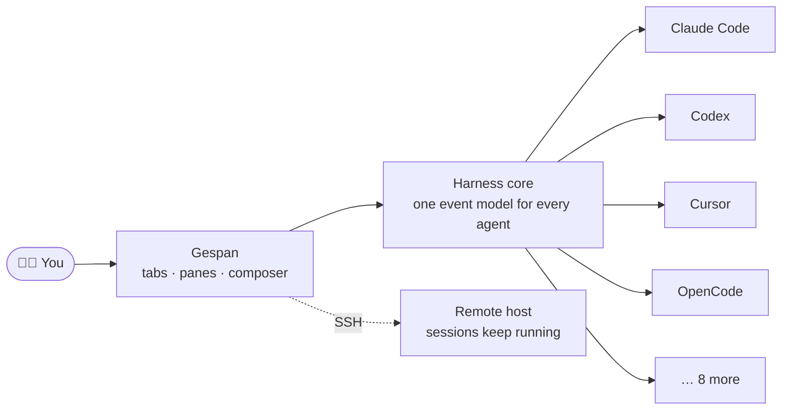

<div align="center">


# Gespan

### One desktop app to drive all of your coding agents.

Run Claude Code, Codex, Cursor, OpenCode and eight more coding agents side by side,<br/>
using the subscriptions you already pay for. No new accounts and no token resale.

<br/>

[](https://github.com/0xvasanth/gespan/actions/workflows/ci.yml)
[](https://github.com/0xvasanth/gespan/releases)
[](LICENSE)
[](#install)
[](https://tauri.app)
[](https://github.com/0xvasanth/gespan/stargazers)

<sub>Gespan began as a fork of [MonoCode](https://github.com/hardbeat920/monocode) and has grown quickly from there. [Read the acknowledgements.](#acknowledgements)</sub>

<br/>

[**Install**](#install) · [**Features**](#features) · [**Providers**](#supported-agents) · [**Docs**](#documentation) · [**Build from source**](#build-from-source) · [**Contribute**](#contributing)

</div>

---

> **Gespan** (pronounced *guh-SPAHN*) is a Dutch word for a *span*: a team of
> draught animals, horses or oxen, harnessed together to pull the plough and the
> wagon on the farm before the work was mechanised. One driver, several animals,
> all pulling in the same direction.
>
> That is what this app does for coding agents. You hold the reins, and a team of
> agents does the pulling.

## Why Gespan?

Coding agents are good now, and you probably use more than one. Each one comes
with its own terminal, its own keybindings and its own idea of what a session
is. Keeping track of five agents across three repos is a job of its own.

Gespan gives them one home:

- **Bring your own agents.** Gespan runs the CLIs you have already installed and
  signed in to. Your existing plans, logins, skills and MCP setup carry over.
- **Tabs are sessions.** Every conversation is a tab. Split panes to watch
  several agents work side by side, each in its own Git worktree if you like.
- **Native and local.** Gespan is built on Rust and Tauri. Sessions are stored on
  your machine, and the app has [no telemetry](docs/privacy.md).
- **You stay in charge.** You can review diffs, keep or undo what each turn
  changed, approve tools and stop runaway agents from a single window.

> [!NOTE]
> Gespan does not sell tokens or proxy your requests. It is a GUI over agents
> you already have, and your usage stays between you and your provider.

## Supported agents

If an agent is installed and signed in, Gespan can run it. One is enough to get
started. Gespan checks for each CLI at startup and points you to the install
steps for any that are missing.

| | | | |
| :-- | :-- | :-- | :-- |
| **Claude Code** | **Codex** | **Cursor CLI** | **Grok Build** |
| **OpenCode** | **Antigravity** | **Pi** | **omp** |
| **fx** | **Hermes Agent** | **Kiro CLI** | **Devin CLI** |

Install and login commands for each agent are in [provider setup](docs/providers.md).

## Features

<table>
<tr>
<td width="50%" valign="top">

### 🗂️ Multi-agent workspace
Organize conversations by project, open each one as a tab, and split panes to
run several agents at once. You can switch models, effort levels and permission
modes for each session.

</td>
<td width="50%" valign="top">

### 🌿 Worktrees built in
Give parallel tasks their own Git worktree so agents never step on each other.
A searchable Git history graph sits in the side panel.

</td>
</tr>
<tr>
<td valign="top">

### 🔍 Review and undo
Turn checkpoints record what each turn changed, including edits made through
shell commands. You can keep or undo a turn's diff and review all changes in a
fast diff viewer with syntax highlighting.

</td>
<td valign="top">

### ✍️ Editor and terminal
Edit files in the built-in code editor, preview Markdown, and open terminal tabs
next to your sessions, all in the same window.

</td>
</tr>
<tr>
<td valign="top">

### 🎛️ Agents that drive Gespan
Start a message with `/operator` to let an agent open sessions, split panes,
create worktrees and read your notes. You can also use `/plan` and
`/orchestrator` to change how a turn runs.

</td>
<td valign="top">

### 🧭 Pilots *(experimental)*
Pilots are long-running agents that work across your projects. They keep a
memory, run scheduled habits, write Markdown and HTML reports, and report back
on the sessions they start.

</td>
</tr>
<tr>
<td valign="top">

### 📥 Inbox and automations
Bring in GitHub, GitLab, Linear, Jira and Azure DevOps work items. Start a
session from an issue, or run agents on a schedule or when an inbox event
arrives.

</td>
<td valign="top">

### 🌐 Remote machines *(experimental)*
Connect a Mac, Linux or Windows host over SSH and run sessions there. They keep
running when your laptop closes. An invite-only iPhone companion lets you check
in from your phone.

</td>
</tr>
</table>

## How it works



Each agent has an **adapter** that starts and manages the CLI, and a
**protocol module** that turns the CLI's output into one shared set of event
types. The UI only works with those events, so every agent gets the same tabs,
approvals, diffs and history. The Rust side handles PTYs, the filesystem, Git
and session storage.

## Install

> [!IMPORTANT]
> Install and sign in to at least one [supported agent](docs/providers.md) first.

| Platform | Download |
| :-- | :-- |
| macOS, Apple Silicon | [Gespan.dmg](https://github.com/0xvasanth/gespan/releases/latest) |
| macOS, Intel | [Gespan_x64.dmg](https://github.com/0xvasanth/gespan/releases/latest) |
| Linux, x86_64 | [.deb, .rpm, or AppImage](https://github.com/0xvasanth/gespan/releases/latest) |
| Windows, x86_64 | [Installer](https://github.com/0xvasanth/gespan/releases/latest) |

- **macOS:** open the DMG and drag Gespan to Applications.
- **Windows:** run the installer.
- **Linux:** see [Linux installation](docs/install.md) for dependencies and package instructions.

Installers will appear on the [Releases page](https://github.com/0xvasanth/gespan/releases)
once a release is published. Until then, [build from source](#build-from-source).

## Quick start

1. **Open a project folder.** Gespan groups your sessions by project.
2. **Pick an agent and a model.** Any installed agent appears in the picker.
3. **Send a message.** The session opens as a tab, and replies stream in.
4. **Go parallel.** Split the pane, start a second agent, and put it in its own
   worktree so the two never clash.
5. **Review.** Look through the diff, then keep or undo each turn's changes.

> [!TIP]
> Try `/operator start two Codex sessions: one to inspect the API and one to review the UI`.
> The agent will open and arrange both sessions for you.

Gespan is still early. If something breaks, please [open an issue](https://github.com/0xvasanth/gespan/issues).

## Documentation

| Guide | What's inside |
| :-- | :-- |
| [Provider setup](docs/providers.md) | Install and log in to each supported agent |
| [Linux installation](docs/install.md) | System dependencies and `.deb` / `.rpm` / AppImage packages |
| [Agent access with `/operator`](docs/agent-access.md) | Let agents open sessions and manage worktrees and notes |
| [Remote sessions](docs/remote-access.md) | Run agents on another machine over SSH *(experimental)* |
| [Jira inbox](docs/jira.md) | Connect Jira Cloud to the Inbox |
| [Building from source](docs/building.md) | Platform prerequisites and packaging |
| [Privacy](docs/privacy.md) | What is recorded locally and what never leaves your machine |
| [Gespan Native](docs/native/README.md) | The experimental Rust + GPUI app |

## Build from source

You'll need **Node.js 20+**, **[Bun](https://bun.sh)** and a stable
**Rust** toolchain. See [build setup](docs/building.md) for platform
dependencies and packaging.

```bash
git clone https://github.com/0xvasanth/gespan.git
cd gespan
bun install
bun run tauri dev
```

Before opening a pull request, run the same checks CI runs:

```bash
bun run check   # vitest, tsc, cargo fmt, cargo clippy, cargo test
```

The mobile app is a separate Expo project in [`mobile/`](mobile/README.md).
Run it with `cd mobile && bun install && bun run start`.

<details>
<summary><strong>Project layout</strong></summary>

<br/>

| Path | What lives there |
| :-- | :-- |
| `src/app/` | App composition, startup, window shell, release and update UI |
| `src/features/` | Product features: sessions, workspace, pilots, inbox, automations and more |
| `src/integrations/harness/` | The provider-independent harness core and one adapter per agent |
| `src/platform/tauri/` | Browser-to-Tauri adapters for filesystem, PTY and clipboard |
| `src-tauri/` | Rust backend: PTYs, filesystem and Git, session storage, native window |
| `crates/` | Shared Rust crates and the experimental GPUI app |
| `host/` | The remote host that runs sessions on another machine |
| `mobile/` | The Expo iPhone companion |

</details>

## Gespan Native *(preview)*

Gespan Native is an experimental rewrite in Rust and [GPUI](https://github.com/zed-industries/zed/tree/main/crates/gpui).
The React/Tauri app is still the production app.

To try it from this checkout on macOS, you need Node.js 22+, Rust and Xcode:

```sh
bun run native:dev     # launch with a separate development database
bun run native:build   # create an optimized app using installed Gespan data
```

In the development terminal, type `r` and press Enter to rebuild and restart.
There is no hot reload. The release app saves changes to your installed Gespan
data. See the [native guide](docs/native/README.md) for prerequisites, build
output, checks and current limitations.

> [!WARNING]
> Gespan Native shares `~/Library/Application Support/dev.gespan.desktop/gespan.db`
> with Gespan. Close both apps and back up `gespan.db` before you first use
> Gespan Native. Do not open the same conversation in both apps at once: Gespan
> saves whole conversations and can overwrite turns added in Gespan Native.

## Contributing

Contributions are welcome, and small, focused pull requests get merged fastest.
Bug reports, protocol fixes and tests for the existing agents help the most.

- Read [CONTRIBUTING.md](CONTRIBUTING.md) before opening a pull request.
- For changes to product direction, open an issue first.
- New agent adapters are on hold for now while the existing ones are aligned.
  [CONTRIBUTING.md](CONTRIBUTING.md#new-providers) explains why.
- Be kind: [Code of Conduct](CODE_OF_CONDUCT.md). Report security issues
  privately as described in [SECURITY.md](SECURITY.md).

### Contributors

Thanks to everyone who has helped build Gespan.

<a href="https://github.com/0xvasanth/gespan/graphs/contributors">
  
</a>

## Acknowledgements

Gespan is a fork of [MonoCode](https://github.com/hardbeat920/monocode), the
open-source GUI for coding agents created by
[hardbeat920](https://github.com/hardbeat920) and its contributors, and it would
not exist without their work. Gespan's core ideas come from that project, as
does much of its code. These include tabs as sessions, a provider-independent
harness, and running the agents and subscriptions you already have.

Gespan builds on that foundation and has expanded rapidly in its own direction,
with new features, more agents and many fixes. Fixes still come in from
upstream regularly. The original MIT copyright notice is kept in
[LICENSE](LICENSE). If Gespan is useful to you, please give the original
project a star too.

## License

Gespan is released under the [MIT License](LICENSE).

Provider names and logos are trademarks of their respective owners. See [NOTICE](NOTICE).

<div align="center">
<br/>
<sub>If Gespan saves you a few terminal windows, consider giving it a ⭐</sub>
</div>
