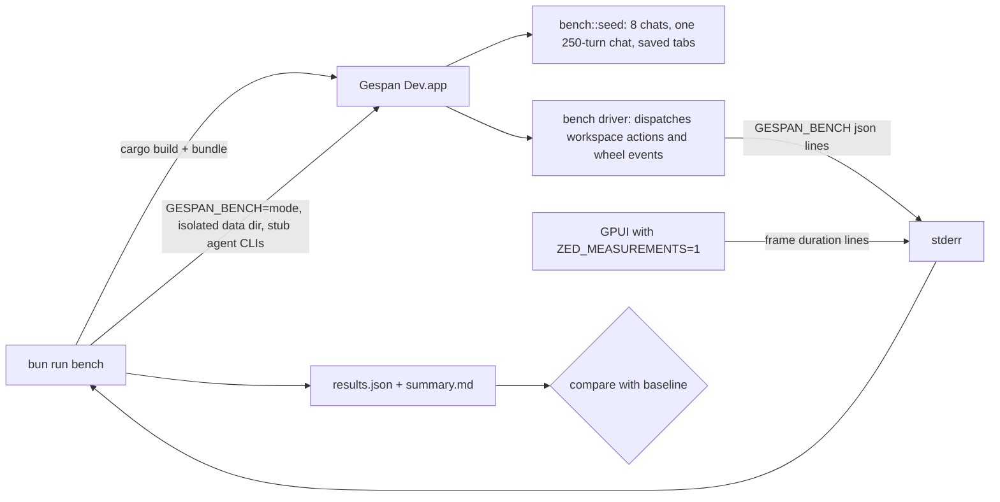

# Dev-mode benchmarks

`bun run bench` measures the native app as you run it in development: the
`native-dev` build, bundled as **Gespan Dev.app** with development data, the
same app `bun run dev` launches. It answers four questions with numbers
instead of guesses:

| Stage | What it measures |
|---|---|
| Startup | Launch → `app.run`, → first frame painted, → interactive (the first input the shell answers with a painted frame). Idle RSS 3 s later. Median of 5 launches after one warm-up. |
| Interaction | Frame draw time and input → paint latency (p50/p95/max) while switching tabs, scrolling a long chat, and opening and closing panes. |
| Memory | Footprint and RSS before and after 20 open/close cycles (two splits, the terminal and the right panel, then a round of tab switches). Footprint growth is the leak signal: macOS compresses and purges resident pages, so RSS alone moved by −45 MB in a run that leaked nothing. |
| Soak | The same actions in a loop for 15 minutes. Counts crashes (the app is relaunched and the run continues), panics and UI hang reports. |

Release builds are not benchmarked: the driver only exists in debug builds.

## Running it

```bash
bun run bench
```

The full suite takes about 20 minutes, most of it the soak. Shorter runs:

```bash
bun run bench --quick
```

```bash
bun run bench --soak 2m --only startup,interaction
```

| Option | Default | Meaning |
|---|---|---|
| `--soak <90s\|15m\|1h>` | `15m` | Soak length; `0` skips it. |
| `--startup-runs N` | 5 | Measured launches (plus one warm-up). |
| `--cycles N` | 20 | Open/close cycles for the leak check. |
| `--only a,b` | all | Any of `startup`, `interaction`, `soak`. |
| `--quick` | | 2 launches, 5 cycles, a 60 s soak. |
| `--no-build` | | Reuse the last `native-dev` build and bundle. |
| `--save-baseline` | | Store this run as the baseline (refused if it crashed, panicked or hung). |
| `--baseline PATH` | `crates/gespan-gpui/bench/baseline.json` | Compare against another file. |
| `--out DIR` | `output/bench/<time>/` | Where results go. |

While it runs, leave the Gespan Dev window in front and the Mac otherwise
quiet. GPUI throttles an inactive window to 30 fps and a covered window may
not paint at all; the summary warns when steps ran in the background or the
load average was above the core count. Several sessions building at once
inflate every timing.

### Narrowing a soak to one action group

When the soak's footprint grows, find the action that drives it by running
the soak with only one group:

```bash
GESPAN_BENCH_SOAK_ONLY=splits bun run bench --only soak --soak 3m --no-build
```

| Value | Each round |
|---|---|
| `tabs` | `NextTab` and `ActivateTab` across every tab |
| `scroll` | Scrolls the long chat down and back up |
| `panes` | The full pane cycle |
| `splits` | `SplitRight`, then `CloseTab` |
| `splits_down` | `SplitRight`, `SplitDown`, then `CloseTab` twice |
| `terminal` | Opens and closes the dock terminal |
| `panel` | Opens and closes the right panel |
| `reload` | Opens four extra tabs once, then tab rounds and long-chat scrolls, so chat histories unload and reload |
| `idle` | Waits a second |

Unset, the soak rotates tabs, scroll and panes. A group that is flat alone
can still grow in the rotation: the leak fixed with this table only showed
when splits ran between tab rounds.

## What you get

Each run writes `results.json` (everything, including per-sample memory and
layout checks) and `summary.md` (the tables) to `output/bench/<time>/`, and
prints the summary. The exit code is 1 when a check fails, 2 when the run
could not start.

## Regression checks

Every result is compared with the stored baseline. A timing check fails only
when it is over the relative limit **and** the absolute floor, so a 1 ms
frame becoming 2 ms is not a regression.

| Check | Fails when |
|---|---|
| Startup to first frame / interactive (median) | +25% and +100 ms |
| Idle RSS (median) | +20% and +20 MB |
| Frame p95 per phase | +30% and +2 ms |
| Input → paint p95 per phase | +30% and +5 ms |
| Longest frame per phase | over 250 ms, unless the baseline had one too |
| Footprint growth over the open/close cycles | over 50 MB (no baseline needed) |
| Footprint growth over the soak, from its first sample after 30 s of actions | over 50 MB (no baseline needed) |
| Crashes, panics, hang reports | any (no baseline needed) |

A baseline from a different Mac (model, CPU or memory differ) can't judge
timings, so those checks only warn there. Save a baseline for your machine
with `bun run bench --save-baseline`; the one checked in was recorded on the
maintainer's Mac and names it in its `machine` field.

## How it works



- `crates/gespan-gpui/src/bench.rs` is the in-app driver. With
  `GESPAN_BENCH` set, `main` seeds an empty data directory with eight chats
  (the first one 250 turns long, every fifth reply the tool-heavy chat
  fixture) and a saved workspace that opens them all as tabs, so no run ever
  lands in first-run setup.
- The driver dispatches real workspace actions (`NextTab`, `ActivateTab`,
  `SplitRight`, `SplitDown`, `ToggleTerminal`, `ToggleRightPanel`,
  `CloseTab`) and wheel events over the transcript, the same paths a key
  press or trackpad takes. Input → paint latency is the time from dispatch
  to the start of the frame after the one that painted it, so it includes
  one display refresh.
- Frame draw time comes from GPUI itself: `ZED_MEASUREMENTS=1` prints
  `frame duration:` for every drawn frame. The runner attributes each to the
  phase it fell in.
- A frame's duration includes presenting it. When the GPU or the machine is
  busy, presenting waits for a free drawable and the p50 sits at one display
  refresh (about 16.4 ms); compare runs taken under similar load.
- After every pane cycle the driver records the number of tabs and panes,
  so a cycle that leaves a split or tab behind shows up in `results.json`
  instead of quietly skewing the memory numbers.
- Claude and Codex are stubbed with `GESPAN_CLAUDE_BINARY` and
  `GESPAN_CODEX_BINARY` (a script that answers `--version`); nothing is sent
  to a provider. Each stage starts from a copy of the seeded data in
  `output/bench/<time>/work/`, which is deleted at the end.
- A crash is a non-zero exit, a signal, quitting before the script finished,
  or 90 s without a benchmark event (the runner then kills the app). During
  the soak the app is relaunched on the same data for the remaining time.
  Panics are counted from `panicked at` lines on stderr; hang reports are the
  files the UI watchdog writes to `gpui-hangs/` in the data directory.
- The app's own logs still go to `~/Library/Logs/dev.gespan.native.dev/`.

## Why it is local-only

The suite is not part of CI. GitHub's macOS runners are virtual machines
without a real display or GPU and with neighbours of their own: frame
timings there would measure the runner, not Gespan, and vary far more than
the 25-30% the checks allow. A 20-minute run is also expensive on macOS
minutes. The pure parts (stderr parsing, statistics, the regression rules,
seeding, the scripted cycles) are covered by `bun run test:scripts` and the
`bench` unit tests in `cargo test`, which do run in CI.

Run the suite before merging a change that touches rendering, layout,
startup or memory, and after a large rewrite.
