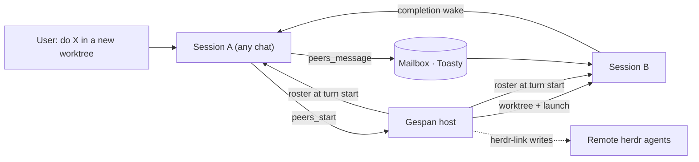

# Agent orchestration: herdr, T3 Code, Wake and Gespan

Research, 2026-11-18. No product code changed. The question:

> When I say "go and do this in the main repo" or "do this in a new worktree",
> Gespan should start and run that work by itself, and every running session
> should know what the other sessions are doing without me relaying it.

Sources read (commit at time of reading):

| Project | Path | Commit | Version | Licence |
|---|---|---|---|---|
| herdr | `~/Developer/Opensource/herdr` | `ee5bfb50` | 0.9.5 | Apache-2.0 |
| T3 Code | `~/Developer/work/0xvasanth/t3code` | `d53873b6` | 0.1.2 | MIT (T3 Tools Inc.) |
| Wake | `~/Developer/work/0xvasanth/Wake` | `79b5295` | 0.9.6 | MIT (Corey Chiu) |
| Gespan | this repo | `76163900` | — | — |

Citations are `path:line` inside each project's own tree.

## TL;DR

- **herdr is a terminal multiplexer with a socket API, not an orchestrator.**
  It owns PTYs, detects agent state by reading the screen, and lets a caller
  type into an agent (`agent prompt`), wait for a state (`agent wait`), and
  read its output (`agent read`). There is no message bus, no task model and no
  MCP server. Agents drive other agents only by following a markdown skill
  that shells out to the `herdr` CLI.
- **Gespan already has more orchestration machinery than herdr**: the `app`
  toolkit (`sessions.start/send/list/read/stop`, `worktrees.create`) and the
  `control` toolkit (`delegate/wait/steer/respond/answer`). However, both are
  gated: `app` only reaches Pilots and `/operator` threads, and `control` only
  reaches an orchestration lead (`crates/gespan-gpui/src/runtime.rs:871-884`).
  An ordinary session can't see or start anything. **The gap is mostly access,
  awareness and UX, not missing plumbing.**
- **T3 Code is the reference design for what the user wants.** Every agent gets
  an MCP server with `delegate_task`, `t3_thread_list/read/send/wait`, and
  worktree-aware launch. Children are real threads with lineage, their results
  wake the parent, and a child can never hold more permission than its parent.
  It is TypeScript, so we port its patterns rather than its code.
- **Wake is not an orchestrator.** It is a read-only, cross-agent session
  history index with a `SessionStart` hook that tells each new session what
  happened recently in that repo. That hook is the cheap half of "sessions know
  about each other". Wake is Rust + GPUI like Gespan, so its adapters can be
  reused nearly as-is.
- **Recommendation (Option A, below):** give *every* Gespan session a scoped
  `peers` toolkit plus a live roster of sibling sessions injected at turn
  start. Build it on the `sessions.*` actions that already exist, and borrow
  T3's lineage, completion-wake and no-escalation rules. Bring herdr's remote
  agents in as peers later, by adding write calls to `herdr-link`.

---

## 1. herdr

### Model and process

- **Entities:**
  - A *workspace* contains tabs, a tab contains panes, and a *pane* is a real
    PTY.
  - An *agent* is a process detected in a pane, with state `blocked`,
    `working`, `done`, `idle` or `unknown`.
  - A *session* is a server namespace with its own socket.
  - A *machine* is an SSH profile.
  - Source: `docs/next/website/src/content/docs/concepts.mdx:8-65`. IDs are
    `w1`, `w1:t1`, `w1:p1` (`skills/herdr/SKILL.md:63-69`).
- **Process:** a detached daemon (`herdr server`, `src/server/autodetect.rs:195-235`).
  It runs `portable_pty` panes (`src/pty/backend.rs:8-24`) with a vendored
  Ghostty VT for terminal emulation.
- **Environment:** every pane gets `HERDR_ENV`, `HERDR_SOCKET_PATH` and
  `HERDR_{WORKSPACE,TAB,PANE}_ID` (`src/pane.rs:202-215`).
- **Starting an agent:** `agent start <name> --kind K --pane P` *types the
  agent's command into an idle shell*. It reports success once screen
  detection sees the agent ready, waiting 30 s by default and at most 300 s
  (`src/app/agents.rs:8-9,145-235`).

### Signalling: what exists

| Primitive | What it does | Where |
|---|---|---|
| `agent.prompt` | Pastes text, then a delayed Enter. Refuses if the target is `blocked`. | `src/app/api/agents.rs:167-270` |
| `pane.send_text/keys/input` | Raw input | `src/app/api/panes.rs:1912,1930,2035` |
| `agent.wait --until S` | Server-side and event-driven. Pinned to the current occupant of the pane. | `src/api/wait.rs:364-400` |
| `pane.wait_output --match/--regex` | Polls the screen | `src/api/wait.rs:22` |
| `agent.read --source visible\|recent\|…` | Scrollback. Auto-scrolls alt-screen agents. | `docs/.../agent-automation.mdx:88-94` |
| `events.subscribe` / `events.wait` | NDJSON stream; 512-event ring; drops slow subscribers with `events_lost` | `src/api/event_hub.rs:1-28`, `src/api/schema/events.rs:19-83` |
| `pane.report_agent[_session]`, `report_metadata` | Hooks push state, session id and display tokens | `docs/.../socket-api.mdx:656-771` |
| Plugin `[[events]]` hooks, `notification.show` | Run a command on an event; show a toast | `docs/.../socket-api.mdx:449-606` |

**State detection** uses TOML regex manifests per agent
(`src/detect/manifests/*.toml`, engine at `src/detect/mod.rs:294-330`), and the
manifests can be updated remotely (`src/detect/manifest_update.rs:16`). For
Claude, Codex, Cursor and others, the installed hook only reports the session
id. Their state still comes from reading the screen. Only pi, omp, opencode,
kilo, kimi and mastracode push authoritative lifecycle state
(`src/detect/mod.rs:330-340`).

### Worktrees

- **Commands:** `worktree list|create|open|remove` (`src/api/schema.rs:70-73`).
  - Creation runs `git worktree add -b <branch> <path> <base>`
    (`src/worktree.rs:239-278`).
  - The default branch name is `worktree/<adjective>-<noun>-<hex4>` (`:21-31`).
  - The default location is `~/.herdr/worktrees/<repo>/<slug>` (`:171-173`).
- **Workspaces:** each worktree opens as a linked child workspace. Removing it
  never deletes the branch.
- **Per-pane settings:** `--cwd` and `env` can be set on
  `workspace/tab/pane/layout` (`src/api/schema/panes.rs:32-38`).

### API surface

- **Protocol:** newline-delimited JSON (`{"id","method","params"}`) over a
  Unix socket, or a named pipe on Windows.
  - It is not JSON-RPC 2.0 (`docs/.../socket-api.mdx:608-650`).
  - There are about 100 methods (`src/api/schema.rs:46-147`). The JSON
    Schema is at `docs/next/api/herdr-api.schema.json`.
  - **Auth:** the socket file mode is `0600`; there are no tokens
    (`src/api/server.rs:29`).
- **Remote:** `herdr --machine X …` tunnels over SSH to
  `herdr remote-api-bridge` (`src/remote.rs:15-39`).
- **CLI groups:** `server api status config channel machine workspace worktree
  tab notification agent terminal pane plugin integration session`
  (`src/cli.rs:115-136`).

### Agent-drives-agent

- The mechanism is `skills/herdr/SKILL.md`, a markdown skill and not an MCP
  server. It is bundled in the binary and printed by `herdr --skill`.
- It teaches an agent to:
  - split a pane, then `agent start` (`:107-137`);
  - `agent prompt --wait` (`:139-147`);
  - `agent wait --until blocked` (`:149-155`);
  - `agent read` (`:164-171`).
- It is not installed automatically.

### No orchestrator

There is no supervisor, plan, task queue or mailbox. Coordination is left to
shell scripts (`docs/.../agent-automation.mdx:100-125`) or to an agent
following the skill.

## 2. Gespan today

### herdr integration: monitor and attach only

- **`crates/herdr-link`** is a generic client.
  - It calls only four methods: `ping`, `agent.list`, `workspace.list` and
    `events.subscribe` (`client.rs:82-103`). It never sends input.
  - The transport actually used is an SSH bridge that starts a headless
    `herdr server` when needed and execs `remote-api-bridge`
    (`ssh.rs:75-105,195-260`).
  - `Connection` keeps a live snapshot and reconnects with backoff up to 60 s
    (`connection.rs:11-44`).
- **`gespan_core::machines`:**
  - pins herdr 0.9.5 (`machines.rs:23`);
  - wraps `herdr machine list/enable/disable/remove/add` (`:103-205`);
  - maps agent state onto sidebar marks (`:394-417`).
- **UI:**
  - Settings → herdr machines (`settings/pages/herdr_machines.rs`).
  - A sidebar "Machines" section (`machines/sidebar.rs`).
  - Clicking an agent runs `herdr agent attach` over SSH in a terminal tab
    (`shell/sidebar_list.rs:720-770`).
  - A desktop notification when a remote agent blocks or finishes
    (`shell/notifications.rs:589-615`).
- **Never done:** Gespan never starts herdr agents, prompts them, waits on
  them or creates herdr worktrees. Local Gespan sessions are not herdr panes.

### Sessions and worktrees

- **Running agents:** Gespan runs agents through structured protocols, not a
  PTY.
  - Claude uses stream-json on stdin/stdout (`provider/claude.rs:19-151`).
  - ACP is used for Kiro and others (`provider/acp.rs`).
  - Codex uses the app-server (`provider/codex.rs`).
  - Provider kinds are listed in `provider/kind.rs:4-32`.
- **Choosing main repo or worktree:** the composer's *Workspace* menu offers
  current checkout, new worktree or an existing worktree
  (`conversation.rs:3055-3085`).
  - A new worktree is cut on first send as `gespan/<first words>`
    (`gespan-core/src/git.rs:683-692`, `runtime.rs:371-400`).
  - It has setup and teardown scripts (`worktree_scripts.rs`) and
    `.worktreeinclude` copying (`worktree_copy.rs`).
- **Status:** status is derived and kept in memory (Idle, Working, Done,
  Attention, Held; `session_mark.rs:50-58`, `shell.rs:2093-2134`). It is not
  a persisted column.
- **Storage:** `SessionRecord` in Toasty (`store/schema.rs:19-51`). There is
  no parent/child lineage on ordinary sessions.

### MCP hub and toolkits

- **`crates/mcp-hub`:**
  - Streamable HTTP on loopback, with a bearer token per session.
  - Toolkits are re-read on every `tools/list`.
  - A stdio relay serves agents that can't reach HTTP.
- **`tool_servers.rs`:**
  - registers the toolkits `visual`, `ticket`, `app`, `control`, `actions`,
    `browser` and `decisions` (`:305-332`);
  - delivers the hub to each provider in that provider's own way (`:363-418`).

**Cross-session powers that already exist**:

| Who | Toolkit | Actions |
|---|---|---|
| Pilots, `/operator` threads | `app` (`app_call`) | `sessions.list` (busy, draft), `sessions.read`, `sessions.start` (`workspaceMode` = current, checkout or worktree; base; placement; `notifyOnComplete`), `sessions.send` (idle only), `sessions.draft/stop/archive/delete`, `worktrees.list/create` (`pilot/actions.rs:100-280`, `shell/app_commands.rs`, `pilots/host.rs:613-625`) |
| Orchestration lead | `control` (`control_call`) | `delegate` (with file scope and `dependsOn`), `wait` (≤25 s), `steer`, `message`, `respond`, `answer`, `retry`, `cancel`, `review`, `finish` (`orchestration.rs:337-406`) |
| Every session | `decisions` | Shared decision log, scoped by repository remote, so worktrees share it (`decisions/scope.rs`) |

Related features: Pilots (delegate with `sessions.start`, completion reports
bundled per chat; `pilot.rs:392`, `pilot/completions.rs`), Flows, Hold, the
Watching chip (`watching.rs`) and orchestration workers in their own
worktrees with only their delta merged back (`orchestration/worktree.rs`).

**Gating:** `runtime.rs:871-884` mounts `app` only for a Pilot or for a thread
with `/operator` turned on, and mounts `control` only for an orchestration
lead. `app_access.rs` blocks one session from turning `/operator` on in
another. Even with access, actions can't target Pilot chats, habit runs or
orchestration workers (`docs/agent-access.md:15`).

## 3. T3 Code

### Architecture

- **Server and clients:** a Node and Effect server is the single owner of
  provider processes, PTYs, git and files. Web, Electron desktop and React
  Native mobile are thin clients over Effect RPC on a WebSocket
  (`docs/internals/overview.md:3-14`, `packages/contracts/src/rpc.ts`).
- **Providers:** each speaks its native protocol behind one adapter
  interface, `ProviderAdapterV2`
  (`packages/provider-core/src/server/ProviderAdapter.ts:599-670`).
  - Codex: app-server JSON-RPC, with a client generated from upstream.
  - Claude: Agent SDK.
  - Grok and the ACP registry: ACP.
  - Also OpenCode and Pi RPC.
- **Persistence:** event sourced in SQLite.
  - Command → decide events → one transaction (events + projections +
    command receipt + outbox) → effect worker (`apps/server/src/orchestration-v2/EventSink.ts:270-291`,
    `docs/internals/overview.md:53-71`).
  - Model: AppThread → Run → ExecutionNode tree → ProviderThread. "App ids
    are primary; provider ids are refs" (`docs/orchestration-v2/README.md:33,62-81`).
- **Capability matrix:** one boolean matrix decides behaviour, with flags
  such as `supportsActiveSteering`, `supportsSteeringByInterruptRestart`,
  `canRollbackThread` and `supportsSubagents`
  (`packages/contracts/src/orchestrationV2.ts:210-320`).

### Run and steer

- **`message.dispatch` modes:** `defer_start`, `steer_active`,
  `restart_active`, `queue_after_active` or `start_immediately`
  (`orchestrationV2.ts:2856-2865`).
  - "auto" steers when it can, falls back to interrupt-and-restart, and
    otherwise queues (`ThreadManagementService.ts:766-781`).
- **Queued messages** are kept on the server and can be edited, reordered or
  promoted to a steer (`docs/user/composer.md:198-222`).
- **Launch** goes through the stages fetch → checkout → setup-script → agent,
  emitting progress events (`ThreadLaunchService.ts:314-390`).

### Cross-thread tools, available to every agent over MCP

| Tool | Purpose |
|---|---|
| `delegate_task` (`async`/`wait`, `clientRequestId`) | Spawn a child thread that gets only the task prompt (`apps/server/src/mcp/toolkits/orchestrator/tools.ts:68`; `docs/orchestration-v2/orchestrator-mcp-server.md:17-20,220-305`) |
| `task_status`, `task_cancel` (recursive) | Track or kill a child and its whole subtree |
| `create_threads` (1–20), `t3_thread_list/read/send/wait/interrupt` | See and drive any thread (`tools.ts:182-264`) |
| `t3_pending_request_*` | Answer another thread's question |
| `t3_thread_launch` (`workspaceStrategy`) | Start in `root`, `existing_worktree` or a new `worktree{baseRef}` (`project/tools.ts:104-107`) |
| `t3_worktree_handoff` | Move a running thread into a new worktree, with a continuation prompt (`worktree/tools.ts:28-41`) |
| `schedule_task` | Interval, fixed-time or webhook triggers (`scheduledTask.ts`) |

Rules worth copying:

- **No escalation.** A child cannot run with broader permission or
  interaction modes than its parent. Changing another thread needs a live
  calling run (`orchestrator-mcp-server.md:497-505`).
- **Lineage and wake-up.** Lineage is recorded as `relationshipToParent:
  "subagent"`, with `subagent_spawn` and `subagent_result` context-transfer
  records. On completion the parent gets a `message.dispatch` carrying
  `delegatedCompletion`, grouped in cohorts. `completionWake` is `always` or
  `settled_only` (`Orchestrator.ts:10534,10741,10917`).
- **Questions route up, approvals don't.** A child's questions are routed to
  its parent; approvals are not (`DelegatedTaskQuestionReactor.ts`).
- **Provenance.** Messages carry `senderThreadId` and `createdBy`, so
  agent-written messages are visibly different from the user's
  (`orchestrator-mcp-server.md:387-397`).
- **Scoped tokens.** Each provider session gets a bearer token scoped to
  environment, thread and capability, revoked on release
  (`McpSessionRegistry.ts:100-125`).
- **Typed failure codes and idempotent retries**
  (`orchestrator-mcp-server.md:510-532`).

### Worktrees

- **Branch naming:** a temporary `t3/<8hex>` branch is created first. After
  launch it is renamed in the background to a name an LLM generates from the
  first message, and the rename is propagated to every thread sharing that
  worktree (`ThreadLaunchService.ts:333-366,468-551`).
- **Setup:** `t3.json` scripts set `runOnWorktreeCreate` and `async` setup,
  so the agent starts while setup runs, and expose marker files
  (`packages/contracts/src/t3ProjectFile.ts:26-70`).
- **Cleanup** is rule-based. A worktree only counts as merged when the PR
  head SHA matches (`apps/server/src/storageCleanup.ts:148-198`).
- **Checkpoints** are hidden refs under `refs/t3/checkpoints`
  (`checkpointing/Utils.ts:4`).

### UX

- **Composer:** each follow-up is queued or steered, with a modifier key for
  the opposite.
- **Agents panel:** children nest under their parent, and stopping the parent
  stops them (`docs/user/thread-sidebar.md:230-235`). Sub-agent threads don't
  take user messages; you talk to the parent.
- **Recovery:** usage-limit auto-resume and restart continuation.
- **Outside access:** outside agents can reach the same MCP server over OAuth
  (`docs/user/outside-agents.md`).

## 4. Wake

- **What it is:** a GPUI app with a pure-Rust core crate, `wake-core`, which
  has no UI and no tokio.
  - It indexes the session files 23 agents leave on disk, including Claude,
    Codex, Cursor, Kiro and OpenCode, into SQLite with FTS5 `trigram`
    search.
  - It is read-only (`crates/wake-core/src/db.rs:36-211`, adapter trait at
    `adapters/mod.rs:47`).
- **No runtime control:** it has no start, steer, wait or worktree creation.
  Its only lifecycle action is *resume in a terminal*, built from a per-agent
  table of resume flags with safe quoting and session ids checked against a
  strict format (`services/terminal/mod.rs:126-440`).
- **Awareness through history:**
  - A Claude Code / Codex plugin runs a `SessionStart` hook that calls
    `wake-cli context`. That injects up to 5 recent sessions from the last
    14 days for the current project, one per agent first
    (`plugins/wake/hooks/hooks.json`, `mcp/tools.rs:304-349`).
  - Project matching covers the exact directory, a directory inside the
    project, and a monorepo root (`services/context.rs:8-17`).
  - A read-only MCP server with five tools (`wake_search`,
    `wake_get_session`, …) runs over a hand-written synchronous stdio loop of
    about 400 lines (`mcp/mod.rs`).
  - "Copy handoff" builds a paste-able prompt that points another agent at a
    session (`cli.rs:845-866`).
- **Process model:** a single writer (the GUI) holds a file lock; CLI and MCP
  readers open the database read-only (`db.rs:467-637`).

## 5. Side-by-side

| | herdr | T3 Code | Wake | Gespan today |
|---|---|---|---|---|
| What it is | Terminal multiplexer and agent daemon | Agent IDE server with web, desktop and mobile clients | Session history browser | Native desktop agent IDE |
| Agent transport | PTY; types command lines | Native protocols (app-server, Agent SDK, ACP, RPC) | None (reads files) | Native protocols (stream-json, ACP, app-server) |
| Agent state | Screen regex; hooks for some agents | Protocol events, event-sourced | Derived from files | Protocol events, in memory |
| Start a session programmatically | `agent start` (CLI/socket) | `create_threads`, `t3_thread_launch`, `delegate_task` | ✗ | `sessions.start`, `control.delegate` (gated) |
| Steer / queue / interrupt | Paste plus Enter, Ctrl-C | Auto, queue, steer or restart, by capability | ✗ | Queue and steer in the UI; `sessions.send` idle-only; `control.steer` (gated) |
| Wait for a session | `agent wait --until`, event stream | `t3_thread_wait`, `delegate_task mode:wait`, completion wake | ✗ | `control.wait` ≤25 s (lead only); Pilot completion reports |
| Read another session | `agent read` (scrollback) | `t3_thread_read` (incremental) | `wake_get_session` | `sessions.read` (gated) |
| Sessions aware of each other | Only through the skill and CLI | Through MCP tools, lineage and the Agents panel | History injected at session start | ✗ for ordinary sessions; shared decision log |
| Message bus | Event stream (UI and plugins, not agents) | Committed event log and notification mailbox | ✗ | ✗ (follow-up delivery receipts exist) |
| Parent/child lineage | ✗ | ✓ (relationship, context transfers, recursive cancel) | Display only (sub-agents) | Orchestration workers and Pilot launches only |
| Worktree on start | `worktree create` (opens a workspace) | `workspaceStrategy`, LLM branch rename, async setup, handoff | ✗ | Composer Workspace menu, `gespan/<words>`, setup scripts |
| Permission safety across agents | Socket file mode | Scoped tokens, no escalation, live-caller rule | Read-only | Per-session hub tokens, `/operator` gate |
| Remote machines | ✓ SSH bridge | ✓ Connect, Tailscale, SSH | ✓ rsync mirror | herdr monitor plus SSH remote host |
| Crash and restart safety | Session persistence, live handoff | Event log, outbox, idempotent commands | Rebuildable index | `in_flight_sessions`, Hold |

### What each does better than Gespan

- **herdr:**
  - Runs *any* terminal agent, even one with no protocol, and keeps it alive
    across client detach.
  - Has one uniform `start/prompt/wait/read` verb set for local and remote
    agents.
  - Ships per-agent state manifests that update remotely.
  - Its worktree-as-linked-workspace model.
- **T3 Code:**
  - Cross-thread tools for every agent, with real safety rules (no
    escalation, scoped tokens, idempotency).
  - Lineage, and completion that wakes the parent.
  - Auto steer, queue or restart chosen by a capability matrix.
  - An event-sourced core, so restarts are safe.
  - Async worktree setup and LLM branch rename.
  - `worktree_handoff`.
- **Wake:**
  - Cross-agent history and search.
  - A zero-effort "where did we leave off" injected into every new session,
    including sessions started *outside* Gespan.

### What Gespan could reuse

| From | What | How | Licence notes |
|---|---|---|---|
| herdr | `agent.prompt` / `agent.wait` / `agent.read` / `agent.start` / `worktree.create` | Add them to `herdr-link` (protocol only; no code copy needed) | Apache-2.0. Copied code needs the licence plus a NOTICE and change marks. `docs/desktop/LICENSE-HERDR-APACHE` already exists. |
| herdr | Detection manifests (`src/detect/manifests/*.toml`) | Already mirrored in `provider/manifest.rs`; could add state regexes for PTY-only agents | Apache-2.0, as above |
| herdr | `SKILL.md` structure | Model for a Gespan "peers" skill for agents without MCP | Apache-2.0 (rewrite, don't copy) |
| T3 Code | Capability matrix, `ProviderAdapterV2` shape, dispatch modes | Port as a Rust trait and enum on `provider` | MIT. Keep the copyright notice if any text is copied; TypeScript means we re-implement anyway. |
| T3 Code | `delegate_task` contract (async/wait, `clientRequestId`, typed errors, no escalation, recursive cancel, `completionWake`) | Shape of the new `peers` toolkit | MIT |
| T3 Code | Command → event → outbox in one transaction | Model for a Toasty-backed orchestration log (Option C) | MIT. Must be Toasty in Gespan. |
| T3 Code | Async setup scripts with markers, temp branch plus LLM rename, `worktree_handoff` | Improve `create_task_worktree` / `worktree_scripts.rs` | MIT |
| Wake | `wake-core` adapters for 23 agents' on-disk formats (≈8k lines of contract tests) | Vendor or depend on it to see sessions started outside Gespan | MIT. Wake uses rusqlite for its own index, so Gespan can only use the parsers and must rebuild any index as Toasty models. FTS5 queries are the allowed raw-SQL exception (CLAUDE.md). Reading *other apps'* databases with rusqlite is allowed. |
| Wake | `SessionStart` context hook pattern and project matching | Inject the sibling roster into new sessions | MIT |
| Wake | Resume-command table and safe quoting | "Open in terminal" for any session | MIT |

## 6. Gap analysis

What "say it and it runs" and "sessions know about each other" need, and where
each piece stands:

| Need | herdr | Gespan | Gap |
|---|---|---|---|
| An ordinary chat can start a session in the main repo or a new worktree when told to | Via skill + CLI | `sessions.start` has `workspaceMode`, but only Pilots and `/operator` threads can call it | **Access.** Expose a scoped start action to every session. |
| The started session runs on its own and reports back | `agent wait` | Pilot `notifyOnComplete`, orchestration `wait` | **Wake-up for ordinary parents.** Reuse the Pilot completion path and the Watching chip. |
| Each session knows its siblings (goal, status, branch, files touched) | `agent list` (state only) | Nothing for ordinary sessions | **Roster.** Generate it and inject it at turn start, plus a tool to read it. |
| Sessions can message each other | Paste into the terminal | `sessions.send` idle-only (gated) | **Mailbox.** Queue the message and deliver it at a safe point, with sender shown, choosing steer, queue or restart by capability. |
| Conflict awareness across worktrees | ✗ | Orchestration-only scope overlap | **Overlap hint.** Compare files changed per worktree and flag overlaps in the roster. |
| Remote herdr agents as peers | Native | Monitor only | **herdr-link writes:** prompt, wait, read, start. |
| Lineage, cancel the whole subtree | ✗ | Workers only | Add a parent column to `SessionRecord` (Toasty migration). |
| Safety | Socket mode | Hub tokens | **No escalation**, plus fan-out and depth limits. |

Neither herdr nor Gespan has a *shared, durable message bus* that agents can
use. T3's committed event log is the closest working example.

## 7. Architecture options

### Option A: a peers toolkit on Gespan's own runtime (recommended)

Gespan stays the runtime. Every session gets a new `peers` toolkit on the
existing MCP hub, plus a roster injected at turn start.

- **`peers_list`:** sibling sessions in the same repository (main checkout
  and all its worktrees). Each entry has title, agent, status, branch or
  worktree, a one-line current goal, files changed, last activity, and the
  parent if any.
- **`peers_read`:** read another session's recent exchanges. Wraps the
  existing `sessions.read`.
- **`peers_start`:** start work, a scoped `sessions.start`.
  - Takes `prompt`, `harness/model`, `workspace: main|worktree|existing`,
    `base`, `wake: always|settled|never`.
  - It records the parent, inherits the caller's permission mode or a
    narrower one, and is limited in depth and fan-out.
- **`peers_message`:** writes to a Toasty mailbox. The message is delivered
  at the target's next safe point, with the sender shown in the transcript;
  steer, queue or restart is chosen by provider capability.
- **`peers_wait`:** bounded wait. Async wake-up is the default.
- **Roster injection:** a compact sibling summary is prepended to each turn
  only when it has changed. This is the Wake pattern, made live.

**Pros:**
- Mostly reuses code that already exists (`sessions.*`, `worktrees.create`,
  Pilot completion reports, follow-up delivery, MCP hub delivery for all 12
  providers).
- Keeps Gespan's structured transcripts and approvals.
- Works the same for every provider.

**Cons:**
- Gespan becomes the single coordinator, so sessions coordinate only while
  Gespan is running.
- Overlaps with `/operator` and `control`, which need to be folded together
  eventually.

### Option B: herdr as the runtime

Run local agents inside a local herdr server. Gespan becomes a herdr client:
`agent start` in a worktree workspace, `agent prompt`, `agent wait`,
`events.subscribe` for state, and the herdr skill for agent-to-agent control.

**Pros:**
- One model for local and remote machines.
- Agents survive a Gespan restart.
- Any terminal agent works.
- The user's "build on herdr" framing taken literally.

**Cons:**
- herdr steers by *pasting into terminals* and reads state by *regex over the
  screen*. That throws away Gespan's stream-json and ACP transcripts,
  structured approvals, tool cards, MCP mounts and Hold.
- herdr has no bus or lineage, so all the coordination logic still has to be
  written, in Gespan or in the skill.
- It would mean rebuilding the provider layer, a large regression.

**Verdict:** not as the local runtime. **Use herdr for remote machines only**
(milestone A4): add write calls to `herdr-link` so remote herdr agents show
up in the roster and can be started, prompted and waited on like local
peers.

### Option C: a T3-style orchestration core

Replace the Pilot, `/operator`, orchestration and Flows paths with one
event-sourced orchestration core in `gespan-core`:

- commands, events and an outbox in Toasty;
- an AppThread → Run → node tree;
- a capability matrix;
- lineage and context transfers;
- one MCP surface.

**Pros:**
- The cleanest long-term model.
- Restart-safe and idempotent.
- One way to delegate instead of four.

**Cons:**
- Large: it touches the runtime, storage, Pilots, orchestration and Flows.
- The user-visible win comes late.
- Risky while the GPUI parity work is still landing.

**Verdict:** the destination, not the first step. Option A should store its
new state (lineage, mailbox, roster) in shapes that Option C can absorb
later.

### Recommendation

Do **A now, absorb into C later, and bring in herdr for remote machines
(B-lite)**. Milestones:

| # | Milestone | Done when |
|---|---|---|
| A1 | **Roster (read-only awareness):** `peers_list` / `peers_read` for every session, plus roster injection at turn start for sibling sessions in the same repo and its worktrees, with an overlap hint for files changed | Two sessions in different worktrees of one repo each name the other's goal and branch without the user relaying anything. Tests cover the roster contents, change-only injection and the repo/worktree scoping. |
| A2 | **Say it and it runs:** `peers_start` for every session; parent lineage column (Toasty model + migration); completion wakes the parent through the Pilot completion path; child sessions nested under their parent in the sidebar; no escalation; depth and fan-out limits | Typing "do X in a new worktree" in an ordinary chat starts a sibling session in a fresh worktree and reports back to the chat when done. |
| A3 | **Messaging:** a Toasty mailbox, `peers_message` and `peers_wait`; delivery at a safe point with sender shown; steer, queue or restart by a provider capability matrix | Session A asks B a question; B answers at its next idle point; A wakes. |
| A4 | **Remote peers through herdr:** `herdr-link` gains `agent.start/prompt/wait/read` and `worktree.create`; remote agents show in the roster and accept `peers_*` | A local chat starts and steers an agent on a herdr machine. |
| A5 | **External history (optional):** use Wake's adapters so the roster also lists recent sessions run *outside* Gespan in this repo | A Claude Code terminal session from yesterday appears in the roster. |
| C | **Consolidate:** fold `/operator`, `control`, Pilot delegation and `peers` into one orchestration core with an event log | One delegation path; `/operator` removed or kept as an alias. |

## 8. Open questions for the user

1. **Scope of awareness:** should the roster cover only sessions in the same
   repo and its worktrees, or every running session?
2. **Autonomy:** may any chat start sessions without asking (with limits), or
   should `peers_start` ask for one-click approval the first time in each
   chat?
3. **Delivery:** should a message to a busy session steer it right away, or
   always queue until idle?
4. **herdr's role:** remote machines only (recommended), or also as an
   optional local runtime for terminal-only agents?
5. **`/operator`:** once `peers` exists for every session, retire it, or keep
   it as the "full app access" tier above `peers`?
